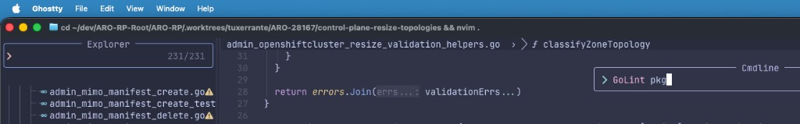
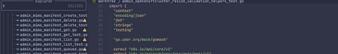
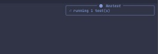

# LazyVim for Go + Claude Code

This is my public LazyVim setup, tuned for large Go codebases, git worktrees,
and a quieter AI-assisted workflow.

Claude Code runs in a side terminal through
[`claudecode.nvim`](https://github.com/coder/claudecode.nvim) on `<leader>a`.
CodeCompanion is also available as a lighter inline assistant, nested under the
same group on `<leader>aC*` (kept off a bare `<leader>C*` prefix since that sat
one shift-key away from LazyVim's `<leader>c` "code" group, e.g. `<leader>ca`
Code Action — an easy, confusing mistype). It talks to a LiteLLM
OpenAI-compatible endpoint, so it does not depend on Copilot.

It started from [LazyVim](https://github.com/LazyVim/LazyVim), but the current
customizations are intentionally opinionated around:

- Go development on large monorepos and worktree-heavy repos
- manual, scoped linting instead of aggressive background `golangci-lint`
- visible progress for async test and command workflows
- a PR review workflow that prepares a worktree and hands the context to Claude Code

> Want to try it without replacing your current Neovim setup? Clone it into a
> separate app profile and launch it with `NVIM_APPNAME`.

## At A Glance

- `:GoLint` is manual and scope-aware instead of running on every edit
- `gopls` defaults are curated for large repos
- `neotest` and lint flows surface progress instead of failing silently
- Aerial exposes ordinary Makefile targets as navigable symbols
- CodeCompanion is available as an alternative chat/inline assistant on
  `<leader>aC*` (nested under the `<leader>a` "ai" group)
- `:PrepReview` creates a dedicated PR review worktree before collecting
  context
- the top `winbar` stays minimal and only adds a small worktree cue

## Why This Setup Exists

On big Go repos, the default "run everything all the time" editor behavior can
feel heavier than it needs to be:

- `golangci-lint` on `InsertLeave` is too much
- background test and lint commands need visible progress
- AI chat is more useful with read-first defaults and less wall-of-text output
- worktree-heavy flows benefit from subtle context instead of loud UI chrome

The goal here is to keep the editor fast while still making the useful bits easy
to trigger on demand.

## Highlights

### Scoped Go linting

`golangci-lint` is removed from the automatic `nvim-lint` loop for Go buffers.
Instead, there is a manual command:

```vim
:GoLint
:GoLint file
:GoLint pkg
:GoLint repo
```

The default scope is `pkg`, so it stays useful on large repos without
accidentally linting everything.

### Makefile symbols in Aerial

The Tree-sitter `make` parser is installed automatically. A local
`queries/make/aerial.scm` query exposes ordinary Makefile rule targets to
Aerial while omitting special dot targets such as `.PHONY`.

### Curated `gopls` defaults

The Go LSP config keeps `gopls` enabled, but forces a few defaults that fit
large repos better:

- `gofumpt`, unimported completion, placeholders, and `staticcheck`
- a small set of extra analyses: `nilness`, `unusedparams`, `unusedwrite`, `useany`
- directory filters that skip `.git`, common editor metadata, and `node_modules`

### Progress feedback for tests and lint

`neotest` and `GoLint` both surface start, progress, and completion
notifications instead of disappearing into the background.

For Go tests specifically, `neotest-golang` prefers `gotestsum` when it is
installed and falls back to the standard `go test` runner otherwise.

### PR review prep with a dedicated worktree

There is a review-focused command for seeding the first Claude Code prompt from
deterministic repo context plus optional GitHub and Jira enrichment:

```vim
:PrepReview https://github.com/owner/repo/pull/123
```

Use `:PrepReview!` to refresh the cached bundle. `!` only affects the
collector cache. It does not change repo matching, worktree selection, switch
behavior, or env bootstrap semantics.

`PrepReview` requires an authenticated GitHub CLI before it starts:
run `gh auth login -h github.com` if needed. It then validates the matching
local repo, creates or reuses a detached `.worktrees/pr-<number>` review
checkout, safely switches the current Neovim session into that worktree,
bootstraps only explicitly allowlisted env symlinks, then collects review
context against the selected worktree before handing it to Claude Code.

The prompt is pasted into the running Claude Code terminal (started first when
none is running) without being submitted, so you can edit it before pressing
Enter. When `claudecode.nvim` is unavailable it is copied to the clipboard
instead.

See `docs/review-prep.md` for the exact behavior and limitations.

### Minimal worktree-aware top bar

The top `winbar` is intentionally minimal. It no longer duplicates the lower
breadcrumb or statusline; it just shows the filename and a small `worktree`
badge when the current file is under a git worktree.

## Screenshots

### Scoped Go lint from the current package



### Minimal worktree-aware top bar



### Test progress feedback without opening extra panels



## Try It Safely

If you want to try the setup without replacing your current config:

```bash
git clone https://github.com/tuxerrante/dot-config-nvim ~/.config/nvim-tuxerrante
NVIM_APPNAME=nvim-tuxerrante nvim
```

That keeps this config isolated from your main `~/.config/nvim` profile.

If you do want to use it as your main config, clone it into `~/.config/nvim`
instead and start Neovim normally.

LazyVim handles plugin bootstrap on first launch.

## Files Worth Reading First

If you want to copy ideas instead of the whole config, these are the main files
worth reading first:

- `lua/plugins/claude.lua`
- `lua/review_prep.lua`
- `scripts/pr_review_prep.py`
- `lua/plugins/go.lua`
- `lua/plugins/test.lua`
- `lua/plugins/aerial.lua`
- `lua/plugins/typescript.lua`

## Notes For Go Developers

This repo assumes you already have a working Go toolchain. The nicest
experience comes from having these available on your machine:

- `go`
- `gopls`
- `golangci-lint`
- `goimports`
- `gofumpt`
- `gotestsum` (optional; used automatically by `neotest-golang` when available)

## Linuxbrew Dependencies

The configured linters, formatters, and language servers are installed through Linuxbrew. Check the required tools without
changing your system:

```bash
bash scripts/install-linuxbrew-dependencies.sh --check
```

Install missing tools with:

```bash
bash scripts/install-linuxbrew-dependencies.sh --apply
```

The script uses the official HashiCorp tap for `terraform`; all other tools are
Homebrew core formulae. Ensure Homebrew is available in the environment that
launches Neovim, for example:

```bash
eval "$(/home/linuxbrew/.linuxbrew/bin/brew shellenv bash)"
```

## Contributing And Security

Contributor docs live in `CONTRIBUTING.md`, including the disposable test
workflow:

```bash
bash scripts/test-in-disposable-env.sh
```

Security reports should go through `SECURITY.md` and GitHub private
vulnerability reporting, not a public issue.
